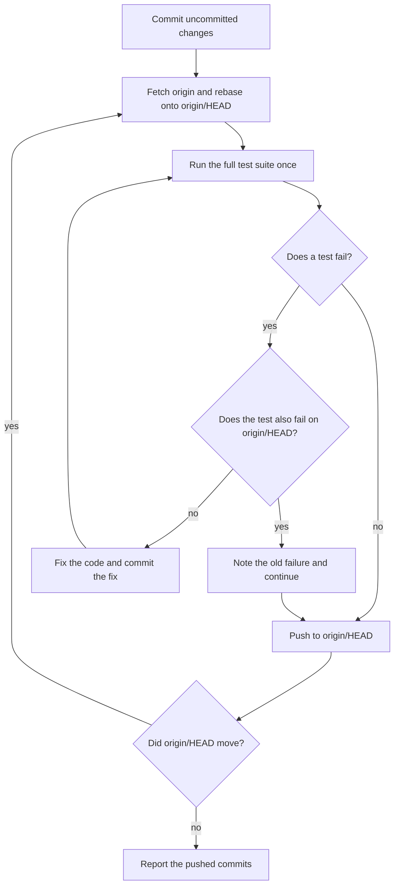

# skills

The repository holds the agent skills I use every day, and each skill works in Claude Code and Codex.

## Install the skills

Run the following command to install the skills:

```bash
npx skills add bjoernaagaard/skills
```

## Skills for git work

The `ship`, `rebase`, `restack`, and `review` skills move local changes onto the default branch on GitHub, which git calls `origin/HEAD`. You start a skill by typing its name, e.g., "ship".

| Skill | What the skill does |
|---|---|
| `ship` | It commits all changes, rebases them onto `origin/HEAD`, runs the tests, and pushes. |
| `rebase` | It moves the current commits onto the newest `origin/HEAD` and keeps uncommitted changes. |
| `restack` | It rewrites the commits since the branch started into small commits that are easy to review, and it does not push. |
| `review` | It asks a second agent to review the current changes, and it reports the findings that hold up. |

The `ship` skill follows the steps of the `rebase` skill, so install both. The diagram shows the order of the steps in `ship`.



When `ship` rebases again after a rejected push, it reruns the tests only if a conflict fix changed files.

## Skills for writing

| Skill | What the skill does |
|---|---|
| `adhd-reply` | It shapes replies for a reader with ADHD, and it repairs a reply the reader could not use. |
| `bluf` | It starts a status update or report with what the reader must do or decide. |
| `sbar` | It writes a handover as Situation, Background, Assessment, and Recommendation. |
| `scholarly-paper-revision` | It revises LaTeX papers for correct math, clear explanations, and consistent notation. |

## Skills for engineering

| Skill | What the skill does |
|---|---|
| `honest-performance` | It measures, profiles, and speeds up software, and it checks claims about speed. |
| `model-router` | It decides whether to hand work to a second agent, and which model and effort level the agent gets. |
| `simplify-change` | It removes code that a change does not need, and it keeps the required behavior. |

## How a skill is stored

Each skill has its own folder with the instructions and an optional settings file for Codex.

```text
skills/
└── ship/
    ├── SKILL.md            # instructions the agent follows
    └── agents/
        └── openai.yaml     # name, summary, and example prompt for Codex
```

## License

The skills use the MIT license, and the [LICENSE](LICENSE) file holds the full text.
